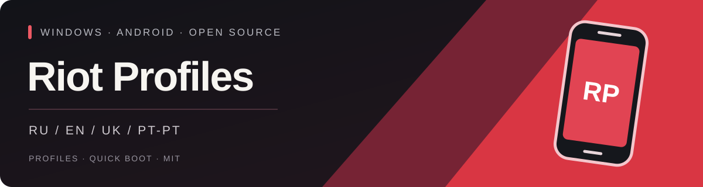
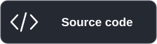

<p align="center"></p>

<p align="center"><strong>Independent Android profiles. One Windows launcher.</strong><br />No Android Studio. Your apps, accounts and saved data stay separate.</p>

<p align="center">
  <a href="https://github.com/BrainMcLore/riot-profiles/releases/latest"></a>
  <a href="https://github.com/BrainMcLore/riot-profiles/actions/workflows/release.yml"></a>
  <a href="LICENSE"></a>
  
</p>

**🇬🇧 English** · [🇷🇺 Русский](README.ru.md) · [🇺🇦 Українська](README.uk.md) · [🇵🇹 Português (Portugal)](README.pt-PT.md)

<p align="center">
  <a href="https://github.com/BrainMcLore/riot-profiles/releases/latest/download/RiotProfiles-Setup.exe"></a>
  <a href="https://github.com/BrainMcLore/riot-profiles/releases/latest/download/install.ps1"></a>
  <a href="https://github.com/BrainMcLore/riot-profiles/archive/refs/heads/main.zip"></a>
</p>

---
[🚀 Install](#installation) · [✨ Features](#features) · [🌍 Languages](#languages) · [🛡️ Privacy](#privacy) · [🛠️ Build](#development)

<a id="features"></a>
## ✨ Your profiles, your space

| | What you get |
| :--- | :--- |
| 👥 **Multiple profiles** | Create as many saved profiles as your storage allows. No fixed application limit. |
| 🔐 **Separate Android data** | Each profile has its own accounts, apps, device keys, saved data and Quick Boot state. |
| 🎮 **Choose and launch** | Select a profile in the dark launcher, launch it, or bring an open profile to the front. |
| ⚡ **Quick Boot** | Resume saved state, or use a cold boot without wiping profile data. |
| 🖥️ **Desktop shortcuts** | Open the launcher to choose a profile, or create a shortcut directly to one profile. |
| 📦 **Shared system image** | Android tools and the read-only base image are shared; profile data is independent. |
| 🌍 **Four UI languages** | English, Russian, Ukrainian and Portuguese from Portugal. |

You can keep multiple devices open at once. The practical limit depends on RAM,
CPU and available emulator ports. Existing emulators are not imported or modified.

<a id="installation"></a>
## 🚀 Get started

### 🪟 Windows installer

1. Download **[RiotProfiles-Setup.exe](https://github.com/BrainMcLore/riot-profiles/releases/latest/download/RiotProfiles-Setup.exe)** and run it.
2. Choose a language, read the Google component licences and accept them to install Android (~2 GB download).
3. Click **Add profile**, give it a name, then click **Launch**.
4. Inside Android, sign in to Google Play and install **Riot Mobile by Riot Games**.
5. Sign in to your Riot account inside the official app. Each new profile needs its own sign-in.

The ready-made EXE does not require Python, Android Studio or administrator rights.
The first boot takes longer; later launches use Quick Boot. Close the Android window
normally and wait for its state to be saved.

### 💻 PowerShell

Download **[install.ps1](https://github.com/BrainMcLore/riot-profiles/releases/latest/download/install.ps1)**, inspect it, then run:

```powershell
.\install.ps1
```

The script downloads the EXE from this repository, checks it against `SHA256SUMS` and
opens setup. It does not use `Invoke-Expression` or change your execution policy.
If scripts are blocked on your PC, use the EXE installer instead.

<details>
<summary>⚙️ Offline files, forks and unattended installation</summary>

With the installer and `SHA256SUMS` already downloaded into the same folder:

```powershell
.\install.ps1 -SetupPath .\RiotProfiles-Setup.exe
```

For a fork, pass `-Repository OWNER/REPO`. For unattended installation, **read the
Google licences first**, then explicitly accept them:

```powershell
.\install.ps1 -AcceptGoogleLicenses
```

This does not automate Google or Riot sign-in. Accounts are added inside Android.

</details>

### 🧰 System requirements

| Component | Requirement |
| :--- | :--- |
| OS | Windows 10 / 11 **x64**, Intel or AMD processor |
| Virtualisation | Hardware virtualisation and **Windows Hypervisor Platform** |
| RAM | **8 GB minimum**, 16 GB recommended for multiple devices |
| Disk | **15 GB free** for installation and the first profile; extra space for more profiles |
| Per active device | Approximately **3 GB RAM** |

The installer does not change BIOS, virtualisation or Windows security settings.
See Google's [hardware acceleration guide](https://developer.android.com/studio/run/emulator-acceleration) if required.

<a id="languages"></a>
## 🌍 Choose your language

**🇬🇧 English · 🇷🇺 Русский · 🇺🇦 Українська · 🇵🇹 Português (Portugal)**

A language picker appears when setup or the launcher opens. Your choice is saved.
You can turn off the startup picker and change the language later using the button
in the launcher's top-right corner. Profile names and Android data are unchanged.
The launcher language does not change Android, Riot Mobile or Google's original licence texts.

<a id="privacy"></a>
## 🛡️ Your data stays on your PC

- The project does not bundle accounts, passwords, ADB keys or existing Android devices.
- The launcher does not request your Google or Riot credentials and sends no analytics.
- Each profile has its own writable Android storage. The base system image is shared read-only.
- Removing a profile permanently removes its apps and accounts **after confirmation**.
- [`uninstall.ps1`](uninstall.ps1) removes the launcher and its shortcuts while preserving Android data.

| Location | Contents |
| :--- | :--- |
| `%LOCALAPPDATA%\Programs\RiotProfiles` | Installed launcher and icon |
| `%LOCALAPPDATA%\RiotProfiles` | Shared SDK, local profiles and preferences |

Never publish runtime folders or device logs. Profile separation is not protection
against a local administrator or malware. Read [Privacy](PRIVACY.md).

<a id="development"></a>
## 🛠️ Build it yourself

Python **3.10+** on Windows. The application uses Python's standard library at runtime.

```powershell
python main.py
python -m pip install -r requirements-build.txt
.\build.ps1
```

The build runs tests, checks the bundled EXE, audits the release for runtime data and
developer home paths, and creates installers, source ZIP and `SHA256SUMS` in `release/`.
Android tools and system images are downloaded from Google during installation, not
redistributed in the EXE. Setup and launcher use the same open-source code.

GitHub Actions checks pull requests and builds a release when a `v*` tag is pushed.
For a new application version, update both version constants in `app/core.py` and
`app/__init__.py`, then push a matching version tag. Keep `data/`, `sdk/`, `build/`,
`dist/` and `release/` out of Git.

## 📜 Licence & project status

**[MIT](LICENSE)** for the launcher source and project-created icon. Third-party
components keep their own licences: [Third-party notices](THIRD_PARTY.md).

This is an **unofficial community project**, not affiliated with Riot Games or Google.
Riot Mobile sign-in, MFA, QR codes and notifications may behave differently in an emulator.
Compatibility and faster startup than other emulators are not guaranteed. Software graphics
without Vulkan are used for compatibility. Release binaries are currently unsigned.
