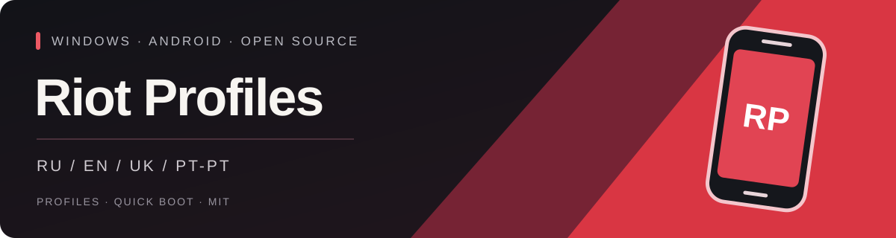
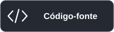

<p align="center"></p>

<p align="center"><strong>Perfis Android independentes. Um só lançador para Windows.</strong><br />Sem Android Studio. Aplicações, contas e dados guardados separados.</p>

<p align="center">
  <a href="https://github.com/BrainMcLore/riot-profiles/releases/latest"></a>
  <a href="https://github.com/BrainMcLore/riot-profiles/actions/workflows/release.yml"></a>
  <a href="LICENSE"></a>
  
</p>

[🇬🇧 English](README.md) · [🇷🇺 Русский](README.ru.md) · [🇺🇦 Українська](README.uk.md) · **🇵🇹 Português (Portugal)**

<p align="center">
  <a href="https://github.com/BrainMcLore/riot-profiles/releases/latest/download/RiotProfiles-Setup.exe"></a>
  <a href="https://github.com/BrainMcLore/riot-profiles/releases/latest/download/install.ps1"></a>
  <a href="https://github.com/BrainMcLore/riot-profiles/archive/refs/heads/main.zip"></a>
</p>

---
[🚀 Instalar](#installation) · [✨ Funcionalidades](#features) · [🌍 Idiomas](#languages) · [🛡️ Privacidade](#privacy) · [🛠️ Compilar](#development)

<a id="features"></a>
## ✨ O teu perfil, o teu espaço

| | O que podes fazer |
| :--- | :--- |
| 👥 **Vários perfis** | Cria tantos perfis guardados quantos o disco permitir. Sem limite fixo na aplicação. |
| 🔐 **Dados Android separados** | Cada perfil tem as suas contas, aplicações, chaves do dispositivo, dados guardados e estado do Quick Boot. |
| 🎮 **Escolher e iniciar** | Seleciona um perfil no lançador escuro, inicia-o ou traz uma janela já aberta para a frente. |
| ⚡ **Quick Boot** | Retoma o estado guardado ou faz um arranque a frio sem apagar os dados do perfil. |
| 🖥️ **Atalhos no ambiente de trabalho** | Abre o seletor de perfis ou cria um atalho direto para um perfil. |
| 📦 **Imagem de sistema partilhada** | As ferramentas e a imagem base do Android são partilhadas; os dados dos perfis são independentes. |
| 🌍 **Quatro idiomas** | Português de Portugal, inglês, ucraniano e russo. |

Podes manter vários dispositivos abertos ao mesmo tempo. O limite prático depende
da RAM, do processador e das portas disponíveis. Os emuladores existentes não são importados nem alterados.

<a id="installation"></a>
## 🚀 Primeiros passos

### 🪟 Instalador para Windows

1. Transfere **[RiotProfiles-Setup.exe](https://github.com/BrainMcLore/riot-profiles/releases/latest/download/RiotProfiles-Setup.exe)** e executa-o.
2. Escolhe um idioma, lê as licenças dos componentes da Google e aceita-as para instalar o Android (~2 GB de transferência).
3. Clica em **«Adicionar perfil»**, dá-lhe um nome e clica em **«Iniciar»**.
4. No Android, inicia sessão no Google Play e instala o **Riot Mobile da Riot Games**.
5. Inicia sessão na tua conta Riot dentro da aplicação oficial. Cada novo perfil requer o seu próprio início de sessão.

O EXE pronto a usar não requer Python, Android Studio nem permissões de administrador.
O primeiro arranque demora mais; os seguintes utilizam o Quick Boot. Fecha a janela
do Android normalmente e aguarda até o estado ficar guardado.

### 💻 PowerShell

Transfere **[install.ps1](https://github.com/BrainMcLore/riot-profiles/releases/latest/download/install.ps1)**, lê o script e executa:

```powershell
.\install.ps1
```

O script transfere o EXE deste repositório, verifica-o com `SHA256SUMS` e abre o
instalador. Não utiliza `Invoke-Expression` nem altera a política de execução.
Se o teu PC bloquear scripts, utiliza o instalador EXE.

<details>
<summary>⚙️ Ficheiros locais, forks e instalação sem diálogos</summary>

Se já tiveres o instalador e o ficheiro `SHA256SUMS` na mesma pasta:

```powershell
.\install.ps1 -SetupPath .\RiotProfiles-Setup.exe
```

Para um fork, indica `-Repository OWNER/REPO`. Para uma instalação sem janelas de
licenciamento, **lê primeiro as licenças da Google** e aceita-as explicitamente:

```powershell
.\install.ps1 -AcceptGoogleLicenses
```

Isto não automatiza o início de sessão na Google ou na Riot. As contas são adicionadas no Android.

</details>

### 🧰 Requisitos do sistema

| Componente | Requisito |
| :--- | :--- |
| Sistema operativo | Windows 10 / 11 **x64**, processador Intel ou AMD |
| Virtualização | Virtualização por hardware e **Windows Hypervisor Platform** |
| Memória | **Mínimo de 8 GB**, 16 GB recomendados para vários dispositivos |
| Disco | **15 GB livres** para a instalação e o primeiro perfil; espaço adicional para mais perfis |
| Por dispositivo ativo | Aproximadamente **3 GB de RAM** |

O instalador não altera a BIOS, a virtualização nem as definições de segurança do Windows.
Se necessário, consulta o [guia de aceleração da Google](https://developer.android.com/studio/run/emulator-acceleration).

<a id="languages"></a>
## 🌍 Escolhe o idioma

**🇵🇹 Português (Portugal) · 🇬🇧 English · 🇺🇦 Українська · 🇷🇺 Русский**

O seletor de idioma aparece ao abrir o instalador ou o lançador. A escolha fica guardada.
Podes desativar a seleção ao iniciar e mudar o idioma mais tarde através do botão
no canto superior direito. Os nomes dos perfis e os dados do Android não mudam.
O idioma do lançador não altera o Android, o Riot Mobile nem os textos originais das licenças da Google.

<a id="privacy"></a>
## 🛡️ Os teus dados ficam no teu PC

- O projeto não inclui contas, palavras-passe, chaves ADB nem dispositivos Android existentes.
- O lançador não pede as tuas credenciais da Google ou da Riot e não envia dados analíticos.
- Cada perfil tem armazenamento Android próprio; a imagem base é partilhada apenas para leitura.
- Eliminar um perfil remove definitivamente as suas aplicações e contas **após confirmação**.
- [`uninstall.ps1`](uninstall.ps1) remove o lançador e os atalhos, preservando os dados do Android.

| Pasta | Conteúdo |
| :--- | :--- |
| `%LOCALAPPDATA%\Programs\RiotProfiles` | Lançador instalado e ícone |
| `%LOCALAPPDATA%\RiotProfiles` | SDK partilhado, perfis locais e preferências |

Não publiques pastas de dados nem registos dos dispositivos. A separação dos perfis
não protege contra administradores locais ou software malicioso. Consulta a [política de privacidade](PRIVACY.md).

<a id="development"></a>
## 🛠️ Compilar a partir do código-fonte

Python **3.10+** no Windows. A aplicação utiliza apenas a biblioteca padrão do Python durante a execução.

```powershell
python main.py
python -m pip install -r requirements-build.txt
.\build.ps1
```

A compilação executa os testes, verifica o EXE, impede a inclusão de dados Android e
caminhos pessoais do programador e cria os instaladores, o ZIP do código-fonte e o
ficheiro `SHA256SUMS` em `release/`. As ferramentas e a imagem do Android são transferidas
da Google durante a instalação e não são incluídas no EXE. O instalador e o lançador usam o mesmo código aberto.

O GitHub Actions verifica pull requests e cria uma versão quando é enviada uma etiqueta `v*`.
Para uma nova versão, atualiza as duas constantes em `app/core.py` e `app/__init__.py`
e envia a etiqueta correspondente. Não adiciones ao Git as pastas `data/`, `sdk/`,
`build/`, `dist/` e `release/`.

## 📜 Licença e estado do projeto

**[MIT](LICENSE)** para o código do lançador e o ícone criado para o projeto. Os componentes
de terceiros mantêm as respetivas licenças: [avisos e marcas registadas](THIRD_PARTY.md).

Este é um **projeto não oficial da comunidade**, sem afiliação à Riot Games ou à Google.
O início de sessão no Riot Mobile, a MFA, os códigos QR e as notificações podem funcionar
de forma diferente num emulador. Não são garantidas compatibilidade nem maior rapidez
face a outros emuladores. Para compatibilidade, utiliza-se renderização por software sem Vulkan.
Os executáveis ainda não têm assinatura digital.
