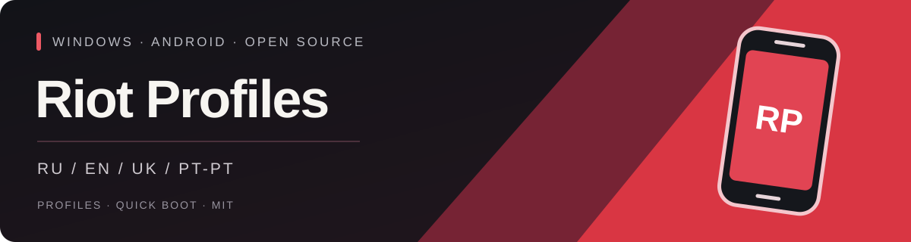

<p align="center"></p>

<p align="center"><strong>Отдельные Android-профили. Один лаунчер для Windows.</strong><br />Без Android Studio. Раздельные приложения, аккаунты и сохранения.</p>

<p align="center">
  <a href="https://github.com/BrainMcLore/riot-profiles/releases/latest"></a>
  <a href="https://github.com/BrainMcLore/riot-profiles/actions/workflows/release.yml"></a>
  <a href="LICENSE"></a>
  
</p>

[🇬🇧 English](README.md) · **🇷🇺 Русский** · [🇺🇦 Українська](README.uk.md) · [🇵🇹 Português (Portugal)](README.pt-PT.md)

<p align="center">
  <a href="https://github.com/BrainMcLore/riot-profiles/releases/latest/download/RiotProfiles-Setup.exe"></a>
  <a href="https://github.com/BrainMcLore/riot-profiles/releases/latest/download/install.ps1"></a>
  <a href="https://github.com/BrainMcLore/riot-profiles/archive/refs/heads/main.zip"></a>
</p>

---
[🚀 Установка](#installation) · [✨ Возможности](#features) · [🌍 Языки](#languages) · [🛡️ Данные](#privacy) · [🛠️ Сборка](#development)

<a id="features"></a>
## ✨ Твой профиль — твоё пространство

| | Что умеет лаунчер |
| :--- | :--- |
| 👥 **Несколько профилей** | Создавай столько сохранённых профилей, сколько позволяет диск. Фиксированного лимита нет. |
| 🔐 **Раздельные данные Android** | Свои аккаунты, приложения, ключи устройства, сохранения и состояние Quick Boot у каждого профиля. |
| 🎮 **Выбор и запуск** | Выбирай профиль в тёмном лаунчере, запускай его или выводи уже открытый на передний план. |
| ⚡ **Quick Boot** | Продолжай с сохранённого состояния или выполняй холодный запуск без очистки данных. |
| 🖥️ **Ярлыки на рабочем столе** | Открывай выбор профиля или запускай конкретный профиль отдельным ярлыком. |
| 📦 **Общий образ системы** | Инструменты Android и базовый образ общие; данные каждого профиля хранятся отдельно. |
| 🌍 **Четыре языка** | Русский, английский, украинский и португальский Португалии. |

Можно держать несколько устройств открытыми одновременно. Их количество ограничено
ресурсами ПК и свободными портами эмулятора. Старые эмуляторы не импортируются и не меняются.

<a id="installation"></a>
## 🚀 Быстрый старт

### 🪟 EXE-установщик

1. Скачай **[RiotProfiles-Setup.exe](https://github.com/BrainMcLore/riot-profiles/releases/latest/download/RiotProfiles-Setup.exe)** и запусти его.
2. Выбери язык, прочитай лицензии компонентов Google и прими их для установки Android (~2 ГБ загрузки).
3. Нажми **«Добавить профиль»**, задай название и нажми **«Запустить»**.
4. В Android войди в Google Play и установи **Riot Mobile от Riot Games**.
5. Войди в Riot-аккаунт внутри официального приложения. Для каждого нового профиля вход отдельный.

Для готового EXE не нужны Python, Android Studio и права администратора.
Первый запуск дольше; следующие используют Quick Boot. Закрывай окно Android
обычным крестиком и дождись сохранения состояния.

### 💻 PowerShell

Скачай **[install.ps1](https://github.com/BrainMcLore/riot-profiles/releases/latest/download/install.ps1)**, прочитай скрипт и выполни:

```powershell
.\install.ps1
```

Скрипт скачает EXE из этого репозитория, сверит его с `SHA256SUMS` и откроет установщик.
Он не использует `Invoke-Expression` и не меняет ExecutionPolicy.
Если запуск скриптов запрещён на твоём ПК, используй EXE-установщик.

<details>
<summary>⚙️ Локальные файлы, форки и установка без диалогов</summary>

Если установщик и `SHA256SUMS` уже скачаны в одну папку:

```powershell
.\install.ps1 -SetupPath .\RiotProfiles-Setup.exe
```

Для форка укажи `-Repository OWNER/REPO`. Для установки без окон лицензий
**сначала прочитай лицензии Google**, а затем явно прими их:

```powershell
.\install.ps1 -AcceptGoogleLicenses
```

Это не автоматизирует вход Google/Riot: аккаунты добавляются внутри Android.

</details>

### 🧰 Требования

| Компонент | Требование |
| :--- | :--- |
| ОС | Windows 10 / 11 **x64**, процессор Intel или AMD |
| Виртуализация | Аппаратная виртуализация и **Windows Hypervisor Platform** |
| Оперативная память | **От 8 ГБ**, желательно 16 ГБ для нескольких устройств |
| Диск | **От 15 ГБ свободного места** для установки и первого профиля; дополнительное место для остальных |
| На активное устройство | Примерно **3 ГБ RAM** |

Установщик не меняет BIOS, виртуализацию и параметры безопасности Windows.
При необходимости используй [инструкцию Google по ускорению](https://developer.android.com/studio/run/emulator-acceleration).

<a id="languages"></a>
## 🌍 Выбор языка

**🇷🇺 Русский · 🇬🇧 English · 🇺🇦 Українська · 🇵🇹 Português (Portugal)**

При открытии установщика или лаунчера появляется выбор языка. Настройка запоминается.
Показ выбора при запуске можно отключить, а изменить язык позже — кнопкой справа
сверху. Названия профилей и данные Android не меняются. Язык лаунчера не меняет
язык Android, Riot Mobile и оригинальные тексты лицензий Google.

<a id="privacy"></a>
## 🛡️ Твои данные остаются на ПК

- В проекте нет готовых аккаунтов, паролей, ключей ADB и существующих устройств Android.
- Лаунчер не запрашивает логины Google/Riot и не отправляет аналитику.
- У каждого профиля собственное хранилище Android; базовый образ используется совместно только для чтения.
- Удаление профиля безвозвратно удаляет его приложения и аккаунты **после подтверждения**.
- [`uninstall.ps1`](uninstall.ps1) удаляет лаунчер и ярлыки, сохраняя данные Android.

| Папка | Содержимое |
| :--- | :--- |
| `%LOCALAPPDATA%\Programs\RiotProfiles` | Установленный лаунчер и иконка |
| `%LOCALAPPDATA%\RiotProfiles` | Общий SDK, локальные профили и настройки |

Не публикуй папки данных и журналы устройств. Разделение профилей не защищает
от локального администратора или вредоносного ПО. Подробнее: [конфиденциальность](PRIVACY.md).

<a id="development"></a>
## 🛠️ Самостоятельная сборка

Python **3.10+** на Windows. Во время работы нужна только стандартная библиотека Python.

```powershell
python main.py
python -m pip install -r requirements-build.txt
.\build.ps1
```

Сборка запускает тесты, проверяет EXE, блокирует попадание данных Android и личных
путей разработчика в релиз и создаёт установщики, исходный ZIP и `SHA256SUMS` в `release/`.
Инструменты и образ Android скачиваются с серверов Google при установке, а не входят
в EXE. Установщик и лаунчер используют один открытый исходный код.

GitHub Actions проверяет pull requests и собирает релиз при push тега `v*`.
Для новой версии обнови обе константы в `app/core.py` и `app/__init__.py`, затем
отправь соответствующий тег. Не добавляй в Git папки `data/`, `sdk/`, `build/`,
`dist/` и `release/`.

## 📜 Лицензия и статус проекта

**[MIT](LICENSE)** — для кода лаунчера и созданной для проекта иконки. У сторонних
компонентов свои лицензии: [уведомления и товарные знаки](THIRD_PARTY.md).

Это **неофициальный проект сообщества**, не связанный с Riot Games или Google.
Вход Riot Mobile, MFA, QR-коды и уведомления в эмуляторе могут работать иначе, чем
на телефоне. Совместимость и ускорение относительно других эмуляторов не гарантируются.
Для совместимости используется программная графика без Vulkan. EXE пока без цифровой подписи.
