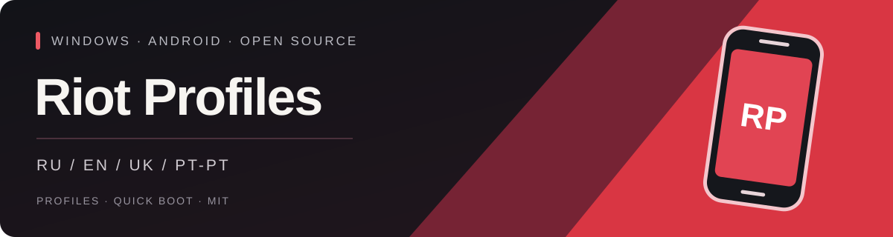

<p align="center"></p>

<p align="center"><strong>Окремі Android-профілі. Один лаунчер для Windows.</strong><br />Без Android Studio. Окремі застосунки, облікові записи та збереження.</p>

<p align="center">
  <a href="https://github.com/BrainMcLore/riot-profiles/releases/latest"></a>
  <a href="https://github.com/BrainMcLore/riot-profiles/actions/workflows/release.yml"></a>
  <a href="LICENSE"></a>
  
</p>

[🇬🇧 English](README.md) · [🇷🇺 Русский](README.ru.md) · **🇺🇦 Українська** · [🇵🇹 Português (Portugal)](README.pt-PT.md)

<p align="center">
  <a href="https://github.com/BrainMcLore/riot-profiles/releases/latest/download/RiotProfiles-Setup.exe"></a>
  <a href="https://github.com/BrainMcLore/riot-profiles/releases/latest/download/install.ps1"></a>
  <a href="https://github.com/BrainMcLore/riot-profiles/archive/refs/heads/main.zip"></a>
</p>

---
[🚀 Встановлення](#installation) · [✨ Можливості](#features) · [🌍 Мови](#languages) · [🛡️ Дані](#privacy) · [🛠️ Збірка](#development)

<a id="features"></a>
## ✨ Твій профіль — твій простір

| | Що пропонує лаунчер |
| :--- | :--- |
| 👥 **Кілька профілів** | Створюй стільки збережених профілів, скільки вміщує диск. Фіксованого ліміту немає. |
| 🔐 **Окремі дані Android** | Власні облікові записи, застосунки, ключі пристрою, збереження та стан Quick Boot для кожного профілю. |
| 🎮 **Вибір і запуск** | Вибирай профіль у темному лаунчері, запускай його або виводь уже відкрите вікно на передній план. |
| ⚡ **Quick Boot** | Продовжуй зі збереженого стану або виконуй холодний запуск без очищення даних. |
| 🖥️ **Ярлики на робочому столі** | Відкривай вибір профілю або запускай конкретний профіль окремим ярликом. |
| 📦 **Спільний образ системи** | Інструменти Android і базовий образ спільні; дані профілів зберігаються окремо. |
| 🌍 **Чотири мови** | Українська, англійська, російська та португальська Португалії. |

Можна тримати кілька пристроїв відкритими одночасно. Їх кількість обмежена ресурсами
ПК і вільними портами емулятора. Наявні емулятори не імпортуються та не змінюються.

<a id="installation"></a>
## 🚀 Швидкий початок

### 🪟 EXE-інсталятор

1. Завантаж **[RiotProfiles-Setup.exe](https://github.com/BrainMcLore/riot-profiles/releases/latest/download/RiotProfiles-Setup.exe)** і запусти його.
2. Вибери мову, прочитай ліцензії компонентів Google та прийми їх для встановлення Android (~2 ГБ завантаження).
3. Натисни **«Додати профіль»**, введи назву та натисни **«Запустити»**.
4. Усередині Android увійди в Google Play і встанови **Riot Mobile від Riot Games**.
5. Увійди у свій Riot-акаунт в офіційному застосунку. Для кожного нового профілю потрібен окремий вхід.

Для готового EXE не потрібні Python, Android Studio та права адміністратора.
Перший запуск триваліший; наступні використовують Quick Boot. Закривай вікно Android
звичайною кнопкою закриття та дочекайся збереження стану.

### 💻 PowerShell

Завантаж **[install.ps1](https://github.com/BrainMcLore/riot-profiles/releases/latest/download/install.ps1)**, прочитай скрипт і виконай:

```powershell
.\install.ps1
```

Скрипт завантажить EXE з цього репозиторію, перевірить його за `SHA256SUMS` та відкриє
інсталятор. Він не використовує `Invoke-Expression` і не змінює ExecutionPolicy.
Якщо запуск скриптів на твоєму ПК заборонено, скористайся EXE-інсталятором.

<details>
<summary>⚙️ Локальні файли, форки та встановлення без діалогів</summary>

Якщо інсталятор і `SHA256SUMS` уже завантажені до однієї папки:

```powershell
.\install.ps1 -SetupPath .\RiotProfiles-Setup.exe
```

Для форку вкажи `-Repository OWNER/REPO`. Для встановлення без вікон ліцензій
**спочатку прочитай ліцензії Google**, а потім явно прийми їх:

```powershell
.\install.ps1 -AcceptGoogleLicenses
```

Це не автоматизує вхід у Google/Riot: облікові записи додаються всередині Android.

</details>

### 🧰 Системні вимоги

| Компонент | Вимога |
| :--- | :--- |
| ОС | Windows 10 / 11 **x64**, процесор Intel або AMD |
| Віртуалізація | Апаратна віртуалізація та **Windows Hypervisor Platform** |
| Оперативна пам’ять | **Від 8 ГБ**, рекомендовано 16 ГБ для кількох пристроїв |
| Диск | **Від 15 ГБ вільного місця** для встановлення й першого профілю; додаткове місце для інших |
| На активний пристрій | Приблизно **3 ГБ RAM** |

Інсталятор не змінює BIOS, віртуалізацію та параметри безпеки Windows.
За потреби скористайся [інструкцією Google з прискорення](https://developer.android.com/studio/run/emulator-acceleration).

<a id="languages"></a>
## 🌍 Вибір мови

**🇺🇦 Українська · 🇬🇧 English · 🇷🇺 Русский · 🇵🇹 Português (Portugal)**

Під час відкриття інсталятора або лаунчера з’являється вибір мови. Налаштування
запам’ятовується. Показ вибору під час запуску можна вимкнути, а змінити мову згодом —
кнопкою у правому верхньому куті. Назви профілів і дані Android не змінюються.
Мова лаунчера не змінює мову Android, Riot Mobile та оригінальні тексти ліцензій Google.

<a id="privacy"></a>
## 🛡️ Твої дані залишаються на ПК

- Проєкт не містить готових облікових записів, паролів, ключів ADB чи наявних пристроїв Android.
- Лаунчер не запитує облікові дані Google/Riot і не надсилає аналітику.
- Кожен профіль має власне сховище Android; базовий образ спільний лише для читання.
- Видалення профілю безповоротно видаляє його застосунки й облікові записи **після підтвердження**.
- [`uninstall.ps1`](uninstall.ps1) видаляє лаунчер і ярлики, зберігаючи дані Android.

| Папка | Вміст |
| :--- | :--- |
| `%LOCALAPPDATA%\Programs\RiotProfiles` | Встановлений лаунчер та іконка |
| `%LOCALAPPDATA%\RiotProfiles` | Спільний SDK, локальні профілі та налаштування |

Не публікуй папки даних і журнали пристроїв. Розділення профілів не захищає від
локального адміністратора чи шкідливого ПЗ. Докладніше: [конфіденційність](PRIVACY.md).

<a id="development"></a>
## 🛠️ Самостійна збірка

Python **3.10+** у Windows. Під час роботи застосунок використовує лише стандартну бібліотеку Python.

```powershell
python main.py
python -m pip install -r requirements-build.txt
.\build.ps1
```

Збірка запускає тести, перевіряє EXE, блокує потрапляння даних Android та особистих
шляхів розробника до релізу й створює інсталятори, ZIP вихідного коду та `SHA256SUMS`
у `release/`. Інструменти й образ Android завантажуються із серверів Google під час
встановлення, а не входять до EXE. Інсталятор і лаунчер використовують той самий відкритий код.

GitHub Actions перевіряє pull requests і збирає реліз після push тега `v*`.
Для нової версії онови обидві константи в `app/core.py` та `app/__init__.py`, потім
надішли відповідний тег. Не додавай до Git папки `data/`, `sdk/`, `build/`, `dist/` і `release/`.

## 📜 Ліцензія та статус проєкту

**[MIT](LICENSE)** — для коду лаунчера та створеної для проєкту іконки. Сторонні
компоненти мають власні ліцензії: [повідомлення й торговельні марки](THIRD_PARTY.md).

Це **неофіційний проєкт спільноти**, не пов’язаний із Riot Games чи Google.
Вхід у Riot Mobile, MFA, QR-коди та сповіщення в емуляторі можуть працювати інакше,
ніж на телефоні. Сумісність і швидший запуск порівняно з іншими емуляторами не гарантуються.
Для сумісності використовується програмна графіка без Vulkan. EXE поки без цифрового підпису.
